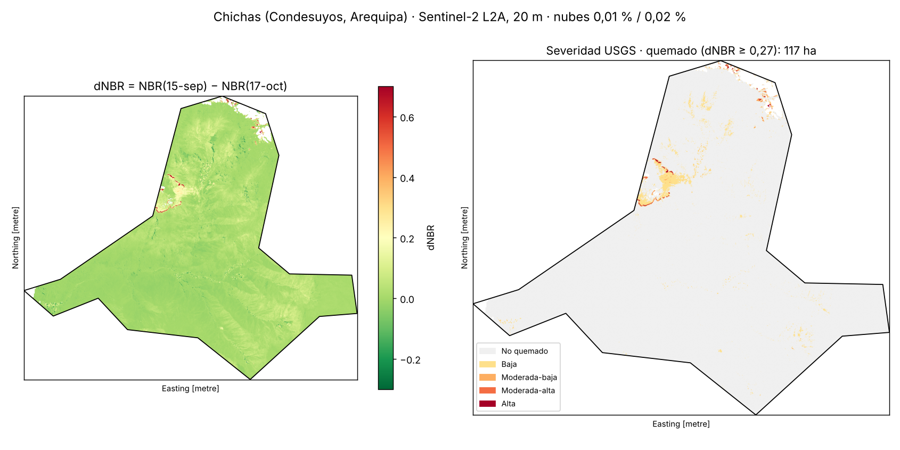
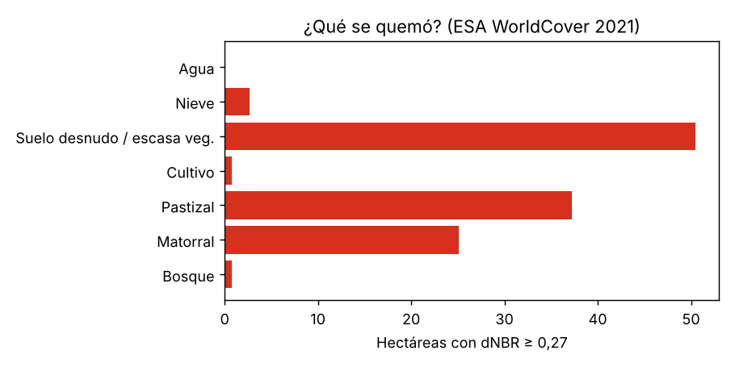

# ¿Cuánto se quemó en Chichas (Condesuyos, Arequipa) en la temporada 2026?

Tarea de la sesión 07 · Raster — **Reto A (otro incendio)** con cruce del **Reto C (¿qué se quemó?)**.



## La pregunta

Chichas aparece entre los incendios activos de octubre de 2026. ¿Cuántas hectáreas se
quemaron dentro del distrito entre mediados de setiembre y mediados de octubre, con qué
severidad y sobre qué cobertura (bosque, matorral, pastizal o cultivo)?

## Datos y fechas

| Dato | Fuente | Fecha | Nubes en el distrito |
|---|---|---|---|
| Imagen **antes** | Sentinel-2 L2A `S2C_18LYH_20260915_0_L2A` (bucket público `sentinel-cogs` en AWS) | 15 set 2026 | **0,01 %** |
| Imagen **después** | Sentinel-2 L2A `S2A_18LYH_20261017_0_L2A` | 17 oct 2026 | **0,02 %** |
| Cobertura del suelo | ESA WorldCover 2021 v200, 10 m (tile `S18W075`) | 2021 | — |
| Límite distrital | INEI, `peru_distrital_simple.geojson` (sesión 06), UBIGEO 040604 | — | — |

El % de nubes de **las 30 escenas** de setiembre y octubre está en
[`salidas/escenas_nubes.json`](salidas/escenas_nubes.json). Se calculó con la capa SCL
**solo dentro del distrito** (clases 3, 8, 9 y 10), no con el % de nubes de toda la escena.

## Método

1. **`01_escenas.py`** — lista las escenas del tile 18LYH y mide nubes dentro de Chichas.
   Elegí el par antes/después más cercano a la temporada con nubes ≈ 0 % y cobertura completa.
2. **`02_dnbr.py`** — NBR = (B8A − B12) / (B8A + B12) a 20 m; dNBR = NBR antes − NBR después.
   Enmascaro en cualquiera de las dos fechas: sin dato, saturado, sombra, **agua**, nubes y
   **nieve** (SCL). Clasifico con los umbrales USGS (Key & Benson): 0,10 / 0,27 / 0,44 / 0,66.
   **Quemado = dNBR ≥ 0,27**. 1 píxel = 0,04 ha. Cruzo con WorldCover remuestreado por moda.
3. **`03_control_nieve.py`** — control de calidad: los bordes de nieve y de lagunas que
   cambian entre fechas también bajan el NBR. Separo el "quemado" que está a ≤ 60 m de un
   píxel enmascarado.

Reproducir (con el entorno del curso: `uv sync --group raster --group geo`):

```bash
cd tareas/07-raster-incendio-chichas
uv run python 01_escenas.py && uv run python 02_dnbr.py && uv run python 03_control_nieve.py
uv run python 04_datos_dashboard.py && uv run python 05_persistencia.py && uv run python 06_dashboard.py  # requiere pillow y scipy
```

No hace falta clave: todo se lee por HTTP desde COGs públicos, solo la ventana del distrito.

## Resultados

| Severidad (dNBR) | Hectáreas |
|---|---:|
| Baja (0,10–0,27) | 740,6 |
| Moderada-baja (0,27–0,44) | 54,8 |
| Moderada-alta (0,44–0,66) | 39,9 |
| Alta (≥ 0,66) | 22,6 |
| **Quemado (≥ 0,27)** | **117,3** |
| … de eso, a ≤ 60 m de nieve/agua (sospechoso) | 37,0 |
| **Quemado robusto** (≥ 0,27 y lejos de máscaras) | **80,4** |



## Dashboard

[`dashboard.html`](dashboard.html) es un archivo autocontenido (5 MB, funciona sin internet:
Leaflet y Chart.js van incrustados). Descárgalo y ábrelo en el navegador. Incluye mapa con
capas (color real antes/después, relieve, dNBR, severidad, fecha de caída del NBR,
WorldCover, parches), tabla de 17 parches ordenable y enlazada al mapa, línea de tiempo
de las 30 escenas con reproducción, sensibilidad al umbral y al par de fechas, cruce
severidad × cobertura, altitud y la tabla de escenas. Se regenera con
`04_datos_dashboard.py` → `05_persistencia.py` → `06_dashboard.py`.

## 3 hallazgos

1. **El fuego estaba activo entre el 15 y el 20 de octubre, y el área todavía no se puede
   cerrar.** El par 15 set → 17 oct da 117 ha (dNBR ≥ 0,27), pero con el 18 oct da 142 ha y
   con el 20 oct 369 ha (dNBR corregido por offset), y **solo 7 ha coinciden en las tres
   fechas** (61 ha entre el 18 y el 20). El NBR del parche 1 cae de −0,10 (15 oct) a −0,64
   (17 oct) y el 18 oct ya se parece a su entorno: es la firma de llamas o humo, no de una
   cicatriz estable. Con el par 15 set → 15 oct casi no hay quemado (~10 ha robustas).
2. **Lo que arde es vegetación altoandina, no bosque**: en el par principal, pastizal 37 ha
   y matorral 25 ha (53 % del quemado). Bosque y cultivo suman menos de 2 ha. El quemado
   robusto está a 4 079 m de altitud media. Las 50 ha de "suelo desnudo / vegetación
   escasa" en la puna suelen ser pajonal ralo.
3. **Un tercio del "quemado" del 17 oct es dudoso**: 37 de 117 ha están pegadas a nieve o lagunas
   (zona del nevado, al norte), donde el cambio de NBR puede ser deshielo y no fuego.
   Incluso en la severidad "alta" (22,6 ha), 7,1 ha (31 %) están junto a esas máscaras.
   Sin este control habría inflado el resultado en ~46 % (117 frente a 80 ha).

## Limitaciones

- **Un foco de calor no es un incendio, y aquí no usé focos**: desde el entorno donde
  trabajé no se podía acceder a NASA FIRMS ni a Planetary Computer, así que no validé el
  parche con focos VIIRS. Es el siguiente paso.
- **El límite distrital está simplificado**: si el incendio "de Chichas" ocurrió en el
  borde o fuera del polígono, aquí no se cuenta.
- **Las fechas importan**: si el fuego empezó antes del 15 de setiembre, la imagen "antes"
  ya está quemada y el dNBR lo subestima. Un incendio de pocos días en pajonal puede
  rebrotar o ser cubierto por ceniza que el viento se lleva.
- **El umbral 0,27 es genérico** (calibrado en bosques de EE. UU.); en puna con poca
  biomasa los incendios reales dan dNBR bajos, así que parte de las 740 ha "baja" podría
  ser fuego leve, o sequía estacional.
- WorldCover es de 2021 y se remuestreó de 10 a 20 m.
